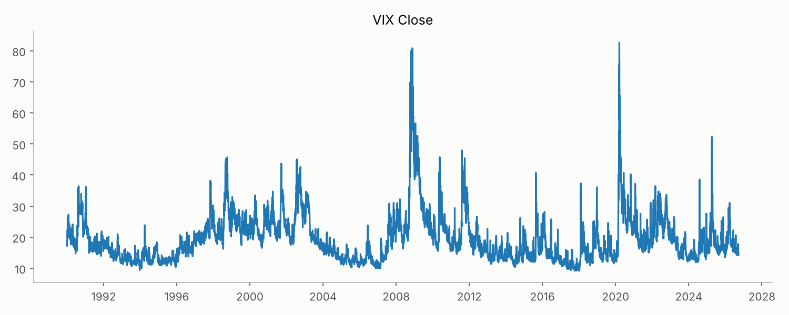
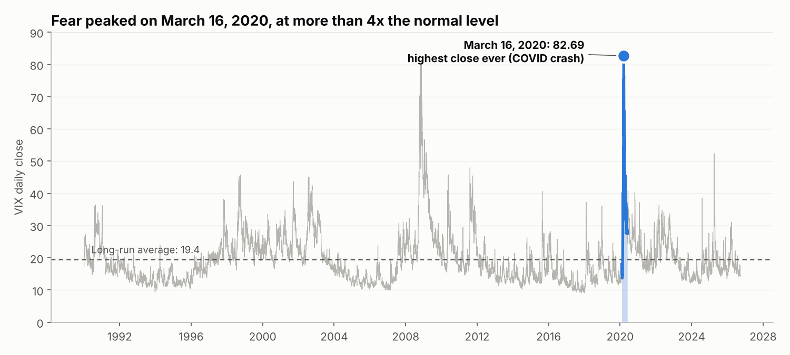
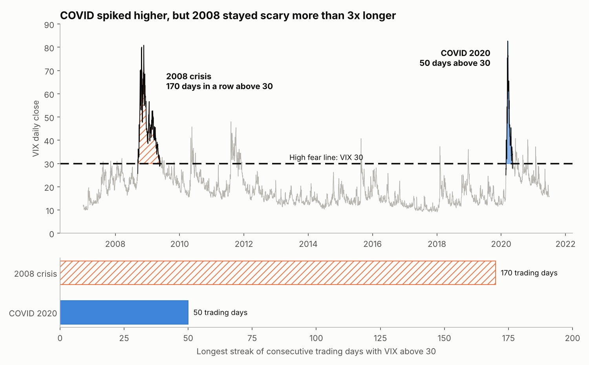

# Module 4 - Design Principles: Line, Shape and Texture

**Clement Scaccia, Data Visualization**

**Data:** Cboe VIX daily close, 1990 to 2026, the cleaned file from my Data Set Repair assignment ([`../Module4/cleaned_data/cboe_vix_daily_cleaned.csv`](../Module4/cleaned_data/cboe_vix_daily_cleaned.csv)). The VIX is the stock market's "fear gauge": the higher it is, the bigger the swings investors expect.  
**Tool:** Python (pandas, matplotlib) in Jupyter Lab  
**Artifact:** [`Module4_Design_Principles.ipynb`](Module4_Design_Principles.ipynb), with the charts also saved in [`images/`](images)

---

## The failure: a default chart with no focal point

This is the default matplotlib line chart. The data is correct, but the chart fails at its job because it has **no focal point**:
- every day of 36 years is drawn with the same thin line in the same color, so nothing stands out
- there's no reference for what a "normal" VIX level is
- the title and labels don't say anything, so the reader has to figure out what matters on their own

Both versions below use the same data and fix this with **line, shape/volume and texture**, but each one leads the reader to a different main point.

---

## Version 1: main point = the highest fear day ever

**Focal point:** March 16, 2020 (COVID crash), when the VIX closed at **82.69**, the highest close in the data set and more than 4x the long-run average of 19.4.

| Principle | How I used it |
|---|---|
| **Line** | All 36 years are a thin light gray line so they stay in the background. Only Feb to May 2020 is a thick blue line, so the eye goes there first. A thin dashed line shows the long-run average as a "normal" reference. |
| **Shape / volume** | A filled area under the COVID section gives the spike weight, and a large circle marks the exact peak day, with a direct label next to it. |
| **Texture** | Left out on purpose. With only one focal point, a pattern would just add clutter. |

---

## Version 2: main point = how long the fear lasted

**Focal point:** COVID had the higher peak, but during the 2008 financial crisis the VIX stayed above 30 for **170 trading days in a row** (Sep 15, 2008 to May 18, 2009), more than 3x as long as COVID's **50 days** (Feb 27 to May 7, 2020). The notebook calculates these streaks from the data.

| Principle | How I used it |
|---|---|
| **Line** | A thick dashed threshold line at VIX 30 ("high fear") anchors the whole chart, since the story is about time spent above it. The VIX line is gray, except inside the two crises where it's dark. |
| **Shape / volume** | Only the area **above 30** is filled, so the size of each shape is the amount of fear. 2008 is long and wide, COVID is tall but narrow. Bars below the chart show the length of each streak so the 170 vs 50 comparison is obvious. |
| **Texture** | 2008 is filled with diagonal hatching and COVID with a solid fill, in both the chart and the bars. The two periods can be told apart by pattern, not just by color, which also works for colorblind readers and black and white printing. |

---

## Summary

| | Main point | Line | Shape / volume | Texture |
|---|---|---|---|---|
| Baseline | none (the failure) | one default line | none | none |
| Version 1 | highest single day (COVID, 82.69) | gray context, thick focus line, dashed average | fill under the spike, circle on the peak | not used on purpose |
| Version 2 | duration of fear (2008: 170 days vs COVID: 50) | thick dashed threshold at 30 | filled shapes above 30, streak bars | hatched 2008 vs solid COVID |

Same data, two different stories. Version 1 answers "when was it worst?" and Version 2 answers "which crisis was actually worse?"
