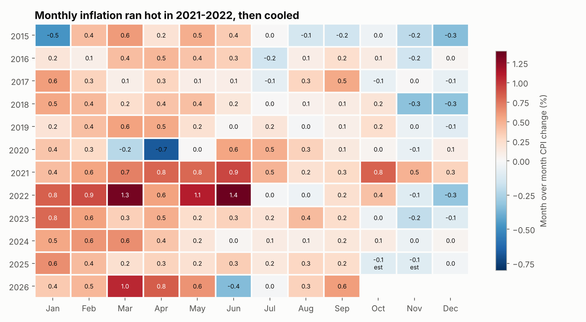
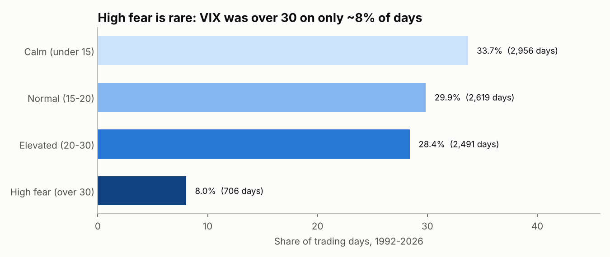
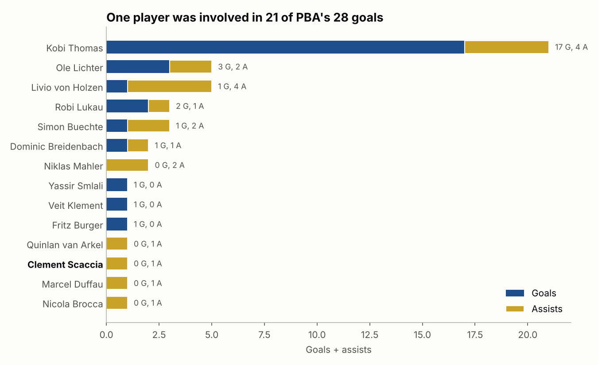

# Module 5 - Data Visualizations in Excel and Python

**Clement Scaccia, Data Visualization**

Three visualizations in Excel and three different ones in Python, all made from my selected and cleaned data sets:
- **US CPI** (BLS), cleaned in Module 4: [`../Module4/cleaned_data/us_cpi_monthly_bls_cleaned.csv`](../Module4/cleaned_data/us_cpi_monthly_bls_cleaned.csv)
- **Cboe VIX**, cleaned in Module 4: [`../Module4/cleaned_data/cboe_vix_daily_cleaned.csv`](../Module4/cleaned_data/cboe_vix_daily_cleaned.csv)
- **PBA men's soccer 2026** (my personal data set): [`../data/personal`](../data/personal)

| Folder | File |
|---|---|
| `Excel/` | [`Module5_Visualizations.xlsx`](Excel/Module5_Visualizations.xlsx), 3 native Excel charts built from formula tables (AVERAGEIFS, COUNTIFS, SUMIFS) |
| `Python/` | [`Module5_Visualizations.ipynb`](Python/Module5_Visualizations.ipynb), 3 matplotlib charts (PNG copies saved in `Python/images/`) |

---

## Excel

| Sheet | Chart | Main takeaway |
|---|---|---|
| Inflation Chart | Column chart of US annual inflation, 2000-2025 | inflation peaked at 8.0% in 2022, and 2009 was the only year prices fell (-0.4%) |
| VIX Chart | Line chart of average VIX by year vs the long-run average (19.4) | the highest-fear years were 2008 (32.7) and 2020 (29.3) |
| Soccer Chart | Stacked bar of W/T/L at home vs away | unbeaten at home (5-0-3), only 1 win on the road (1-4-2) |

The raw data is on the `Data_` sheets, and each chart reads from a summary table built with formulas, so the charts update if the data changes.

## Python

### 1. Monthly inflation heatmap, 2015-2026

Years as rows, months as columns, red = prices up, blue = prices down. The 2021-2022 hot period jumps out right away, which you can't really see in a monthly line chart. The Oct 2025 value is marked "est" because it was estimated in my data repair.

### 2. VIX fear zones

Every trading day since 1992 grouped into zones. The VIX was above 30 ("high fear") on only 8% of days, so the big spikes are rare.

### 3. Goals and assists by player

One player (Kobi Thomas) was involved in 21 of the team's 28 goals. My own line is in bold.

---

## Why these are different in Excel and Python

I used Excel for the standard charts (column, line, stacked bar) where formulas make the summaries easy to check. I used Python for charts that are hard to do in Excel: a heatmap with a centered color scale, binning 8,700+ daily values into zones, and a custom stacked bar with one label highlighted.
