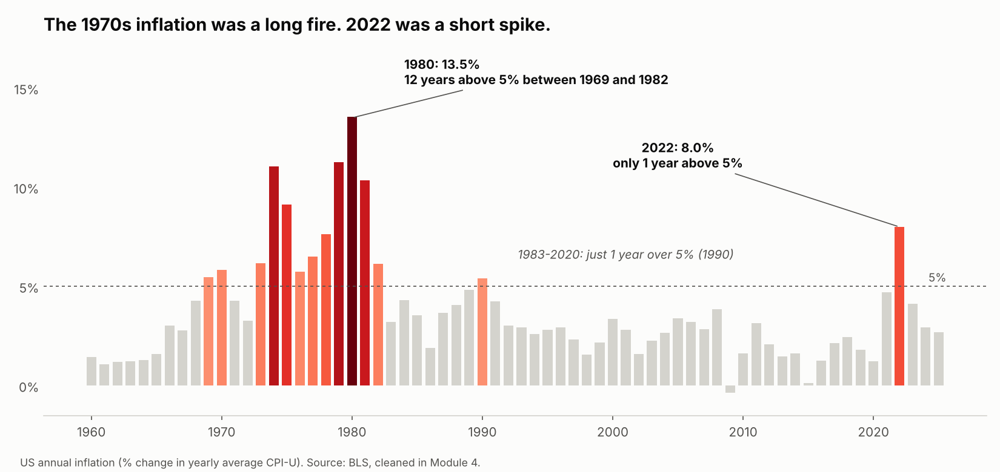
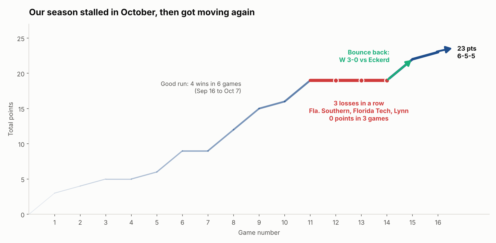

# Module 5 - Design Principles: Space, Motion, Value and Color

**Clement Scaccia, Data Visualization**

**Tool:** Python (pandas, matplotlib), notebook: [`Module5_Design_Principles.ipynb`](Module5_Design_Principles.ipynb)  
**Data:** cleaned BLS CPI ([`../Module4/cleaned_data`](../Module4/cleaned_data)) and my PBA men's soccer 2026 results ([`../data/personal`](../data/personal))

---

## Visualization 1: US annual inflation, 1960-2025

**Focus:** the 1970s-80s inflation was much worse and lasted much longer than the recent spike. Inflation was over 5% in 12 years between 1969 and 1982 (peak 13.5% in 1980), compared to just 1 year in the recent period (8.0% in 2022).

| Principle | How it's used to create the focus |
|---|---|
| **Color** | Every normal year (5% or less) is the same light gray. Only high-inflation years are red, so the eye goes straight to the two red clusters. |
| **Value** | Inside the red, darker means higher inflation (one hue, light to dark). 1974 and 1979-81 are the darkest, and 2022 is a medium red, so you can see it was less severe without reading the axis. |
| **Space** | No gridlines, no box, only a few ticks. That leaves a lot of empty space, and I used it to put the labels right next to the bars they describe. The long gray middle is left empty on purpose so the calm period between the two eras is visible. |
| **Motion** | Not used. This chart compares two periods, so movement would distract from the comparison. |

---

## Visualization 2: PBA men's soccer 2026, points over the season

**Focus:** after a good run (4 wins in 6 games, Sep 16 to Oct 7), the team stalled with **3 losses in a row** (Florida Southern, Florida Tech, Lynn) and then bounced back with a 3-0 win against Eckerd. Points: win = 3, tie = 1, loss = 0.

| Principle | How it's used to create the focus |
|---|---|
| **Illusion of motion** | The line is drawn like a comet trail: early games are thin and faded, recent games thick and solid, so it looks like it's moving left to right. Arrows on the bounce back and at the end push the eye forward, like the season keeps going. |
| **Color** | The losing streak is the only red part, so it's the first thing you see even though it's a flat line, which usually wouldn't stand out. The bounce back is green and the rest stays blue. |
| **Value** | The line gets darker as the season goes on, which adds to the motion effect and puts the weight on the end of the season. |
| **Space** | No gridlines, and only 3 moments are labeled instead of all 16 games, each in the open space next to its part of the line. |

---

## Summary

| | Visualization 1: Inflation | Visualization 2: Soccer season |
|---|---|---|
| **Focus** | 1970s-80s inflation was longer and worse than 2022 | the October losing streak and bounce back |
| **Space** | ✔ | ✔ |
| **Motion** | not used on purpose | ✔ comet trail + arrows |
| **Value** | ✔ darker = higher inflation | ✔ darker = later in the season |
| **Color** | ✔ gray vs red | ✔ red streak, green bounce back |
